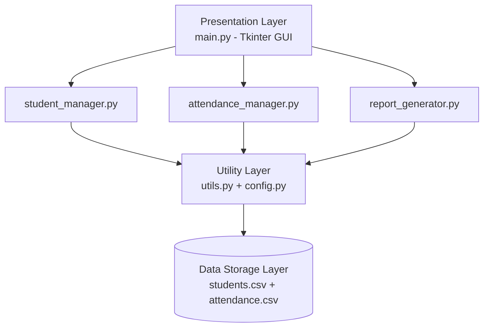
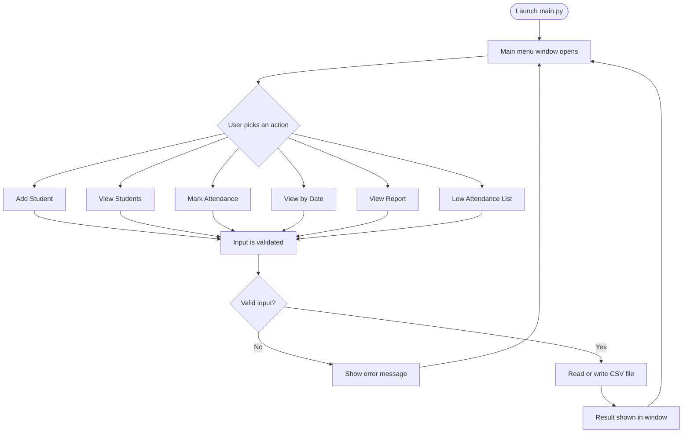
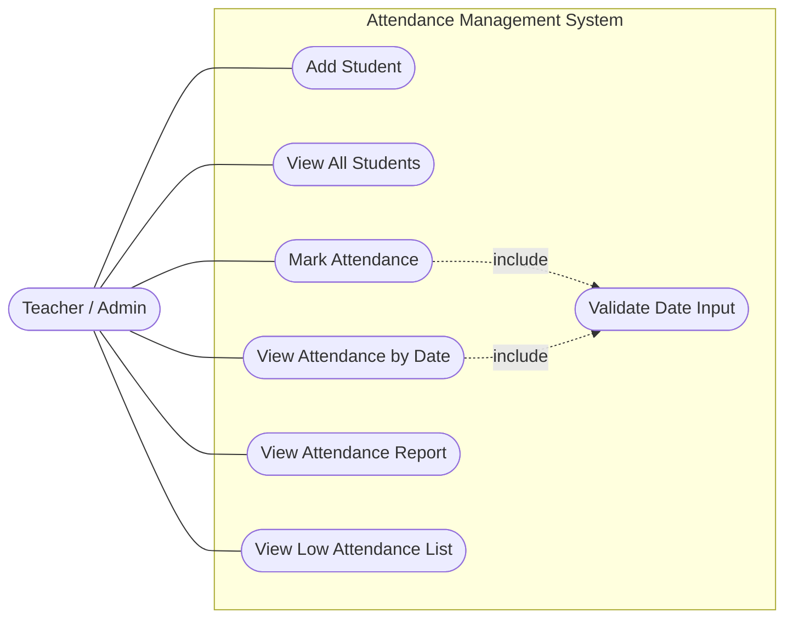
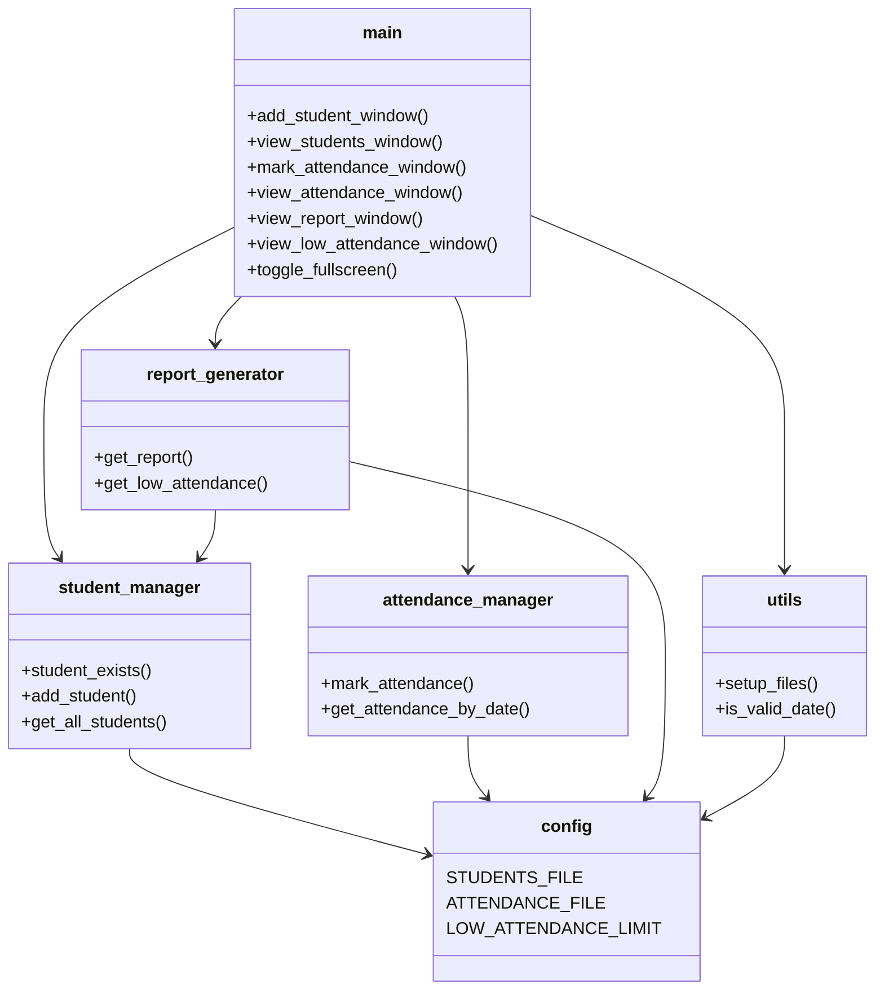
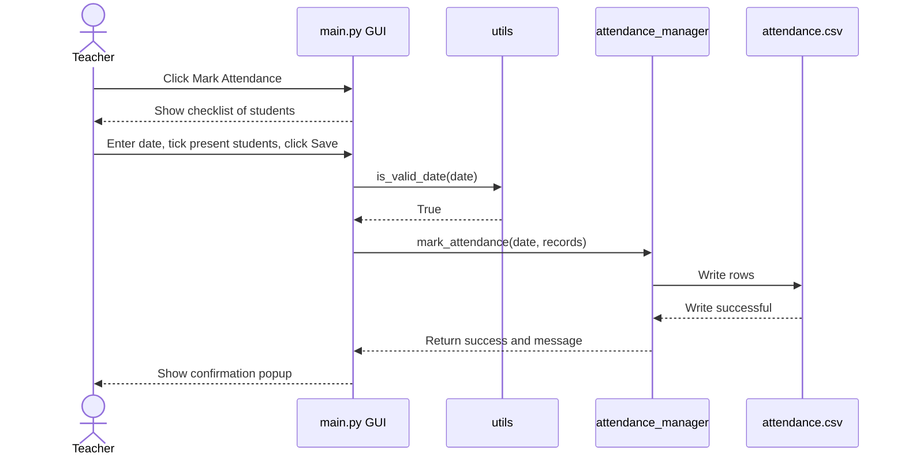
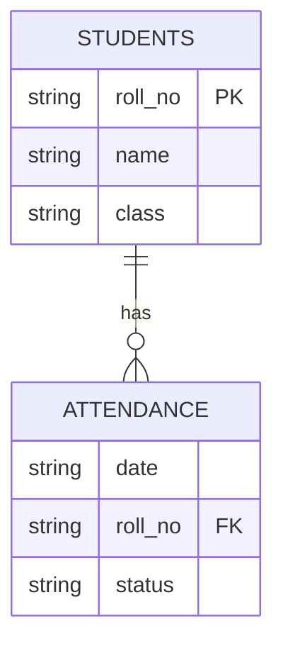

# Design Diagrams - Attendance Management System

All diagrams below are written in Mermaid, so they render directly on GitHub.

---

## 1. System Architecture Diagram

The GUI never touches the CSV files directly. It goes through the manager modules, which use the shared utilities and config.

---

## 2. Process Flow / Workflow Diagram

---

## 3. Use Case Diagram

---

## 4. Class / Component Diagram

The project uses functions instead of full classes, so each box below is one Python module and the functions it provides.

---

## 5. Sequence Diagram - Mark Attendance

---

## 6. ER Diagram (CSV Storage)

The two CSV files behave like two related tables.

